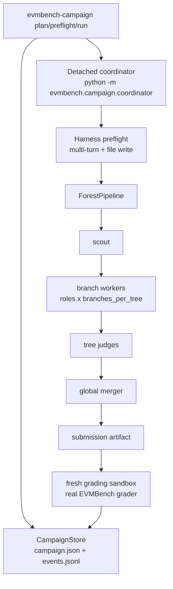
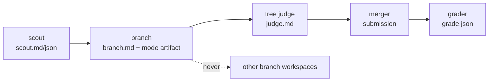
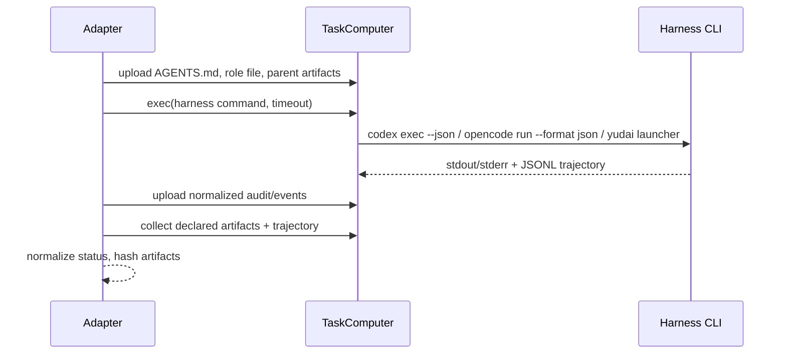
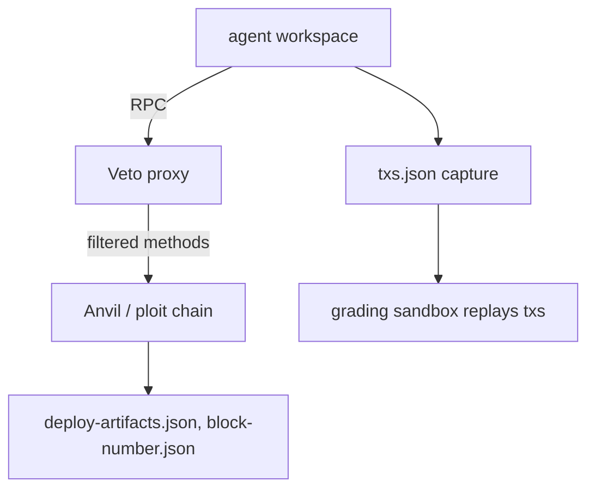
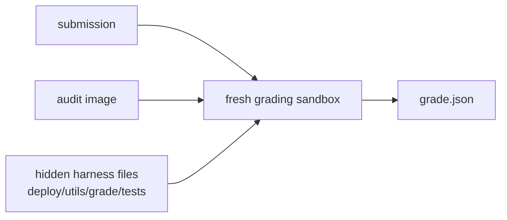
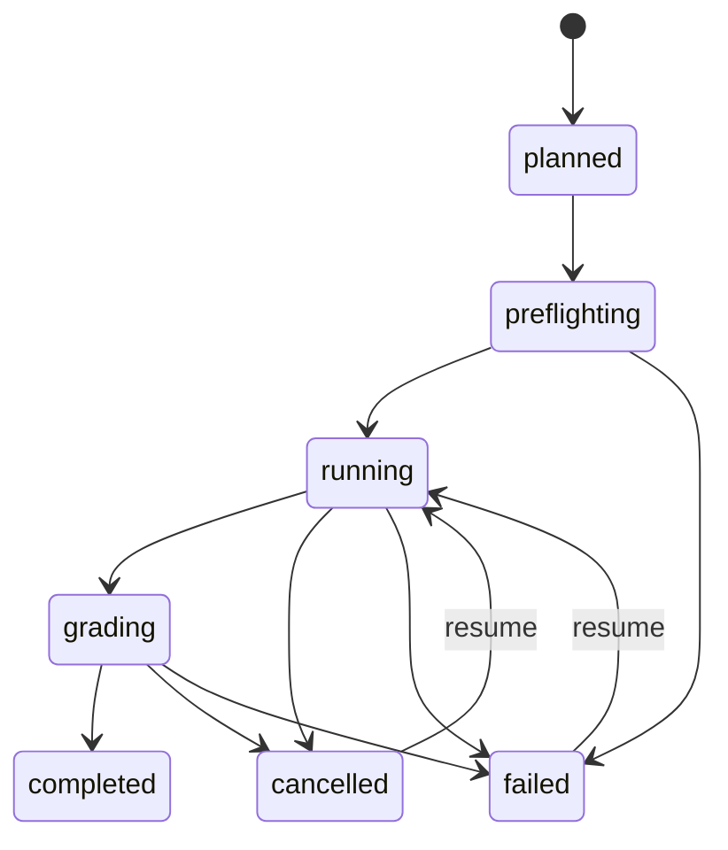

# System Architecture

This document describes how EVMBench executes tasks, runs campaigns, isolates
work, and grades results. For the operator workflow see
[campaign-runbook.md](campaign-runbook.md); for audit packaging see
[audit-catalog-and-modes.md](audit-catalog-and-modes.md).

## 1. Two entry points

| Entry point | Purpose | State |
| --- | --- | --- |
| `evmbench-campaign` | Experiments. Baseline/forest, local/Modal, all harnesses. | Durable campaign directory. |
| nanoeval solver (`EVMBenchSolver`) | Container-agent evaluation and reproduction of classic runs. | nanoeval run directory. |

Both use the same graders. The campaign CLI is the experiment contract; the
nanoeval solver remains supported for container agents.

## 2. Campaign execution



The coordinator never executes candidate tools on the host. Each worker gets a
fresh `TaskComputer`; artifact transfer is typed and hashed.

### Stage and artifact boundaries



- No shared writable audit workspace crosses stages.
- No conversation history crosses stages.
- Judges may inspect the audit repository in their own fresh sandbox, but never
  receive a branch's writable workspace.
- The evaluator never receives the audit workspace.

## 3. Backends

| Backend | Implementation | Use |
| --- | --- | --- |
| `modal` | `evmbench/agents/backend/modal.py` (`modal.Sandbox.create`) | Scaled campaigns. Registry-pullable images. |
| `local` (Docker) | `evmbench/agents/backend/local.py` (`Alcatraz` `LocalCluster`) | Parity checks and offline runs. |
| `local` (process) | `LocalProcessComputer` | Adapter preflight and unit tests. |

Every backend implements the same contract:

```python
class TaskComputer(Protocol):
    def exec(command, *, timeout, env, cwd) -> ExecResult: ...
    def upload(data: bytes, remote_path: str) -> None: ...
    def download(remote_path: str) -> bytes: ...
    def list(remote_dir: str) -> list[str]: ...
    def terminate() -> None: ...
    def side_target(name: str) -> TaskComputer | None: ...
```

Sandbox metadata (id, image, tags) is recorded in every `result.json`.
Campaign-wide sandbox caps are enforced with a counting factory so retries
cannot multiply sandboxes.

## 4. Harnesses



- **Codex** uses the Responses wire API with `store: false`; it never falls back
  to chat completions.
- **OpenCode** preserves the `--format json` JSONL stream.
- **Yudai** runs the benchmark-owned stage launcher in its isolated virtualenv.
  A text-only response is `native_tool_call_required`, not a fenced command.

Status normalization is a pure function (`normalize_status`) so the failure
matrix is unit-tested independently of any provider.

## 5. Modes

### Detect

Branches produce findings; judges verify and deduplicate; the merger writes
`submission/audit.md`. The evaluator compares each vulnerability description
against the report.

### Patch

Branch working trees are captured as `branch.diff` against the base commit.
Judges compare diffs. The merger applies selected diffs in a fresh checkout and
exports `submission/agent.diff`. Grading applies the diff with `--reject`,
restores protected tests, runs the invariant suite, then per-vulnerability
tests.

### Exploit

Each branch gets a fresh chain and its own `deploy.sh` run. The agent talks to
Veto, not raw Anvil, when the sidecar mode is enabled. Branch transaction
bundles are branch-local. The merger replays or re-executes one strategy and
the runner captures `submission/txs.json` from the merger's chain only.



## 6. Grading

Grading is separate from the rollout and runs in a fresh sandbox.



Provenance includes `grade_source`, `grader_version`, `evaluator_model`,
`submission_sha256`, `grading_sandbox_id`, and `score_is_placeholder: false`.

A grader/transport failure is `graded: false`. It is never reported as a
successful zero.

## 7. Test-time scaling

Two orthogonal layers:

1. **Outer attempts** (`n_tries`) repeat a task and feed `pass@k`.
2. **Inner strategy** is `baseline` (one worker) or `forest` (staged pipeline).

To compare strategies, hold the candidate model, evaluator, task set, and total
budget fixed. `plan` prints the expected worker and sandbox counts so budget
parity is checked before spending.

## 8. Durable state and interruption



- State is flushed after every stage transition.
- `SIGINT`/`SIGTERM` set the cancellation flag, terminate live sandboxes, and
  write a partial summary.
- A durable `cancel.requested` file lets any control surface stop the campaign.
- `resume` skips stages whose result is `completed` and whose artifacts are
  intact; everything else is re-executed.

## 9. Pass@k boundaries

`pass@k` is meaningful only when every attempt produced a real grade. A run with
`failed`, `cancelled`, `no_submission`, `contract_violation`, or `not_graded`
results must not be summarized as a clean score. The campaign summary reports
stage statuses and failure modes alongside scores.
