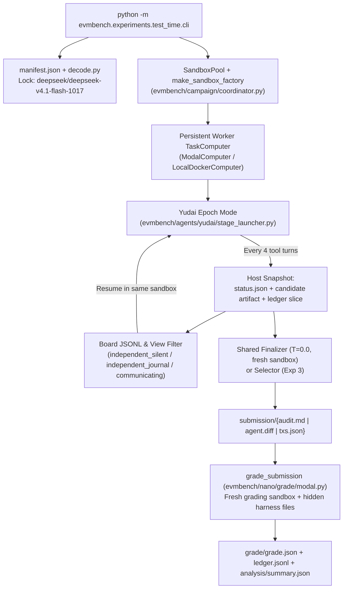

# Five Test-Time Scaling Experiments on EVMBench

This guide documents five test-time compute experiments adapted from four papers to evaluate what actually improves **`deepseek/deepseek-v4.1-flash-1017`** (via OpenRouter) on EVMBench (`detect`, `patch`, and `exploit` modes) at measured expenditure.

It also provides six self-contained, step-by-step implementation and execution prompts under [`prompts/`](prompts/):

- **[`prompts/00-shared-substrate.md`](prompts/00-shared-substrate.md)** — Shared epoch runner, Yudai checkpoint/resume loop, token/USD ledger, board visibility filter, mode artifact capture, and grading integration (`evmbench/experiments/test_time/`).
- **[`prompts/01-communication.md`](prompts/01-communication.md)** — **Experiment 1**: Communicating workers vs. independent workers with identical periodic status records (*Scaling Discovery through Test-Time Communication*).
- **[`prompts/02-breadth-depth.md`](prompts/02-breadth-depth.md)** — **Experiment 2**: Parallel worker breadth (`1, 2, 4, 8`) vs. sequential turn depth (`4, 8, 16, 32, 64`) (*CodeMonkeys*, §2.2 & Figure 5).
- **[`prompts/03-selection.md`](prompts/03-selection.md)** — **Experiment 3**: Comparing candidate selectors (`random`, `review`, `test_vote`, `active`) on the exact same frozen pool of 8 patches (*CodeMonkeys*, §2.3 & Figure 6).
- **[`prompts/04-experience-reuse.md`](prompts/04-experience-reuse.md)** — **Experiment 4**: Second-wave refinement from `fresh`, `self`, `random_peer`, or tournament-selected (`selected_peer`) first-wave summaries (*Scaling Test-Time Compute for Agentic Coding*, §3.2.2 & Table 1).
- **[`prompts/05-stopping.md`](prompts/05-stopping.md)** — **Experiment 5**: Learning cost-aware stopping decisions from complete trajectories with finalizer control (*CASE*, §3–4 & Appendix C.4).

---

## 1. Overview and Recommended Execution Order

| Priority | Experiment | Execution Order | Source Paper & Inspected Code | Core Question |
| --- | --- | --- | --- | --- |
| **0** | **Shared Substrate** | **Run 1st** (`00-shared-substrate.md`) | EVMBench `campaign`, `yudai`, `forest/artifacts`, `nano/grade` | How do all five experiments share one resumable loop, board, ledger, and grader? |
| **1** | **Communicating vs. Independent Workers** | **Run 4th** (`01-communication.md`) | *Scaling Discovery through Test-Time Communication* (§2, §3.4, App. A; `antiherding.py`) | Does reading peers' periodic status records beat independent search at matched turns and matched expenditure? |
| **2** | **Parallel Breadth vs. Sequential Depth** | **Run 2nd** (`02-breadth-depth.md`) | *CodeMonkeys* (§2.2, Fig. 5; `plots.py`, `generated_test_utils.py`) | Should budget go to more parallel workers or longer trajectories per worker? |
| **3** | **Compare Selectors on Frozen Candidates** | **Run 3rd** (`03-selection.md`) | *CodeMonkeys* (§2.3, Fig. 6; `majority_voting.py`, `selection_state_machine.py`) | When DeepSeek generates a valid patch among 8 candidates, can verification methods recognize and submit it? |
| **4** | **Reuse One, Random, or Selected Attempts** | **Run 5th** (`04-experience-reuse.md`) | *Scaling Test-Time Compute for Agentic Coding* (§3.2.2, Table 1) | Do fresh second-wave workers solve tasks when given structured summaries of failed first-wave attempts? |
| **5** | **Learn Stopping from Complete Trajectories** | **Run 6th** (`05-stopping.md`) | *CASE* (§3–4, App. C.4; `core.py`, `replay.py`) | Can observable progress features stop trajectories early while preserving score under a shared finalizer? |

### Why Run Experiment 2 & 3 Before Experiment 1?

1. **Prompt 00** builds `evmbench/experiments/test_time/` once and verifies all unit tests without spending API credits.
2. **Prompt 02** collects the 8-worker × 64-turn `independent_journal` trajectory bank (with snapshots at turns `4, 8, 16, 32, 64`).
3. **Prompt 03** immediately reuses the 8 turn-64 `PATCH` candidates from Experiment 2 as its frozen candidate pool—requiring zero new worker generation runs.
4. **Prompt 01** runs the direct test of the swarm board (`communicating` vs. `independent_journal` vs. `independent_silent`), and can reuse the first 4 workers (`w0`–`w3`) at turn 32 from Experiment 2's `independent_journal` bank.
5. **Prompt 04** reuses all 8 first-wave trajectories at turn 32 from Experiment 2 (`w0`–`w7`) so first-wave collection costs zero additional worker tokens and Recursive Tournament Voting narrows 8 summaries to 4 winners.
6. **Prompt 05** consumes the multi-checkpoint trajectory bank from Experiment 2 to train, calibrate, and replay the cost-aware stopping policy.

---

## 2. Global Model, Provider, and Decoding Lock

Every model call across all five experiments—including workers, status/journal writers, finalizers, review selectors, discriminating test writers, first-wave summarizers, tournament voters, and the `DETECT` grading judge—is locked to a single OpenRouter model:

```text
deepseek/deepseek-v4.1-flash-1017
```

- **Provider routing**:
  - `EVMBENCH_MODEL_PROVIDER=openrouter`
  - `EVMBENCH_EVALUATOR_PROVIDER=openrouter`
  - `OPENROUTER_API_KEY` required for live runs.
  - Inside Yudai (`LitellmModel`): `openrouter/deepseek/deepseek-v4.1-flash-1017`.
  - Inside `DetectGrader` (`OpenAICompletionsTurnCompleter`): `deepseek/deepseek-v4.1-flash-1017` routed to `https://openrouter.ai/api/v1`.
- **No `openai/gpt-6-luna` or auxiliary models**: All `DETECT` scores are paired comparisons under `deepseek/deepseek-v4.1-flash-1017` using the unmodified `JUDGE_PROMPT` in `evmbench/nano/grade/detect.py`. `PATCH` and `EXPLOIT` remain executable graders (`PatchGrader` and `ExploitGrader` via `grade_submission`).
- **Decoding parameters** (written into `manifest.json` and enforced in `decode.py`):

| Call Role | Temperature | Reasoning Effort | Max Output Tokens | Why Locked |
| --- | --- | --- | --- | --- |
| `worker`, `summarizer`, `tournament_vote` | `0.7` | `low` | `4096` | Parallel rollouts and multi-vote tournaments require sampling diversity (`0.0` collapses parallel workers into identical traces). |
| `finalizer`, `selector` (`review`), `test_writer` (`active`) | `0.0` | `low` | `4096` | Deterministic aggregation/selection over a frozen set of candidate artifacts. |
| `detect_judge` | `0.0` (or provider default) | `low` | `4096` | Consistent vulnerability matching across arms (`GradeRequest.reasoning_effort="low"`). |

- **Hint level**: `hint_level="none"` for every experiment and mode.
- **Seed base**: `20261107`.

---

## 3. Detailed Experimental Designs & Paper-to-EVMBench Mapping

### Experiment 1: Communicating Workers vs. Independent Workers

- **Source**: *Scaling Discovery through Test-Time Communication*, §2, §3.4, Appendix A (`antiherding.py`).
- **What the paper ran**: Identical agents operate with separate contexts and communicate via shared files containing findings, negative evidence, candidate results, and adoption records. Atomic directory creation assigns distinct initial search slots. Prompt instructions require an agent to verify evidence before adopting a peer's approach and to preserve variation afterward. On ARC-AGI-3 (25 games, 64 independent trials and 20 team trials per game for team sizes 3 and 5), communicating team-of-5 reaches 8.0% completion vs. 2.2% for independent best-of-5. On a smaller Terminal-Bench check, team-of-2 scored 60.67% vs. 62.36% for oracle pass@2 (a non-deployable oracle comparator).
- **What `antiherding.py` actually implements**: Adoption rules are enforced through structured prompt instructions and shared file schemas rather than a programmatic theorem prover.
- **Why both conditions produce the same periodic status records**:
  Every 4 tool turns, each worker writes a structured status update (`/home/agent/experiment/status.json`), e.g.:
  > *Checked withdrawal accounting in `Curves.sol`. Found a possible stale-balance issue when external fee transfer reverts. Reproduction attempt failed because the fixture did not fund the fee receiver. Next: repair fixture setup and re-run test.*
  - In **`independent_journal`**, each worker writes `/home/agent/experiment/status.json` every 4 turns and sees only its **own** prior updates.
  - In **`communicating`**, each worker writes the exact same `/home/agent/experiment/status.json` every 4 turns and receives **all 4 workers'** updates in `/home/agent/experiment/peer_view.json` at the start of the next epoch.
  - Requiring status updates in both arms isolates **peer visibility** from the cognitive self-reflection benefit of writing a periodic summary.
  - We also include **`independent_silent`** (no mandatory status records, no peer view) as the practical baseline.
- **Surprising result & publishable claim**:
  - *Candidate finding*: Communicating workers outperform equally funded independent workers because partial discoveries compose across workers (e.g., Worker A identifies an accounting inconsistency, Worker B discovers the reachable transaction sequence, Worker C constructs the working exploit/patch).
  - *Convincing evidence*: Log the exact citation chain (`adopted_from`) and run a **live withhold intervention** (`communicating_withhold`) that strips the cited peer records from the board view. If the score gain disappears when those specific records are withheld, the experiment proves collaborative composition rather than random sampling luck.

---

### Experiment 2: Parallel Breadth vs. Sequential Depth

- **Source**: *CodeMonkeys*, §2.2 and Figure 5 (`plots.py`, `generated_test_utils.py`).
- **What the paper ran**: Generated 10 independent trajectories per problem (capped at 8 completions each) and swept parallel sample width (`1..10`) against sequential refinement depth (`1..8`), plotting both **candidate coverage** (oracle pass@k) and **selected-solution performance** against measured inference expenditure. Their sweep reconstructs smaller widths and depths from saved trajectory prefixes and subsets rather than launching new runs for every cell.
- **EVMBench adaptation**:
  - Collect 8 independent trajectories (`w0`–`w7`, arm `independent_journal`, communication disabled) for 64 tool turns (16 epochs of 4 turns) per task.
  - Save runnable artifacts at depth checkpoints **`4, 8, 16, 32, 64` turns** (epochs `1, 2, 4, 8, 16`).
  - Reconstruct the grid of widths **`W ∈ {1, 2, 4, 8}`** × depths **`D ∈ {4, 8, 16, 32, 64}`**.
  - Notice that for a pool of 8 trajectories, the exact number of unique subsets of size $W$ without replacement is $\binom{8}{W} \in \{8, 28, 70, 1\}$. We compute exact coverage across all $\binom{8}{W}$ unique subsets AND 100 bootstrap resamples (with replacement, matching CodeMonkeys), while evaluating the shared finalizer on canonical subsets.
  - Plot both **(1) Candidate Coverage vs. Actual Expenditure** and **(2) Final Submitted Score vs. Actual Expenditure** per mode.
- **Surprising result & publishable claim**:
  - *Candidate finding*: Additional parallel workers help only after each worker has enough sequential turns to complete a full reproduction-and-debugging cycle ($D \ge D^*$). Below $D^*$, dividing budget across more workers *hurts* performance (`8×8` loses to `2×32`). Furthermore, the crossover depth $D^*$ identified on pilot repositories predicts the preferred allocation on unseen confirmation repositories.

---

### Experiment 3: Compare Selectors on the Exact Same Candidates

- **Source**: *CodeMonkeys*, §2.3 and Figure 6 (`majority_voting.py`, `selection_state_machine.py`).
- **What the paper ran**: Froze the generated candidate pool. On that identical pool, random selection scored 45.8%, model review without test filtering performed worse than test voting, the combined test-voting + active discriminating-test selector scored 57.4%, and the oracle upper bound was 69.8%.
- **Simple explanation of Experiment 3**:
  Suppose 8 DeepSeek workers produce 8 candidate patches for a vulnerable contract:
  - **Patch A** blocks the attack by reverting all withdrawals, breaking legitimate user withdrawals.
  - **Patch B** fixes the accounting bug and preserves legitimate withdrawals.
  - **Patch C** looks plausible in prose review but leaves the contract exploitable.
  We freeze those 8 patches (`pool_order` sorted by SHA-256) and give the **exact same 8 patches** to four selectors:
  1. **`random`**: Picks one patch at random ($0$ selection tokens).
  2. **`review`**: DeepSeek ($T=0.0$) reads the task, relevant source files, and the 8 diffs, and chooses one.
  3. **`test_vote`**: Executes all worker-generated tests AND the repository's public test suite (`audit.get_invariant_test_command()`) against the unpatched `base_commit` and each candidate patch. Ranks patches by functionality preservation (`public_tests` green) and regression-test pass count, then deduplicates to retain the top 3 distinct patches.
  4. **`active`**: Starts from the top 3 deduplicated patches from `test_vote`. DeepSeek ($T=0.0$) gets up to 3 rounds to write a new discriminating test, execute it on `base_commit` and the 3 candidates, inspect the outputs, and select the winning patch.
  This cleanly separates:
  - **Generation failure**: None of the 8 patches passes official evaluation ($\text{oracle\_score} = 0$).
  - **Selection failure**: At least one patch passes official evaluation ($\text{oracle\_score} > 0$), but the selector submits a worse patch.
- **Surprising result & publishable claim**:
  - *Candidate finding*: DeepSeek frequently generates a valid security patch inside an 8-worker pool but fails to submit it under `random` or prose `review`; executable verification (`test_vote` + `active`) recovers a large fraction of the oracle gap and beats spending the same tokens on extra unverified candidates.

---

### Experiment 4: Reuse One, Random, or Selected Prior Attempts

- **Source**: *Scaling Test-Time Compute for Agentic Coding*, §3.2.2, Table 1.
- **What the paper ran**: Generated 16 initial rollouts, summarized each rollout, and launched a second wave of 16 rollouts in fresh environments under three refinement contexts: own summary (70.87%), 4 random summaries (75.06%), and 4 summaries chosen via Recursive Tournament Voting with 8 votes per pairwise comparison (78.06%, up from 69.87% in wave 1).
- **EVMBench adaptation**:
  - Reuse the **8 frozen first-wave trajectories** (`w0`–`w7` at turn 32 from Experiment 2) so all second-wave conditions share the exact same first wave at zero extra wave-1 generation cost.
  - Generate one structured summary (`tried`, `observed`, `failed`, `reusable_next_step`, `files_and_functions`) per first-wave worker (`8` summaries total).
  - Run Recursive Tournament Voting (4 pairwise matches × 8 votes at $T=0.7$) to select the **4 winning summaries** from the 8 first-wave summaries.
  - Compare four second-wave arms (each starting from a clean sandbox at `base_commit`—never transferring modified worktrees or chain state):
    1. **`fresh`**: Original task instructions only (essential control so gains cannot be attributed merely to running more attempts).
    2. **`self`**: Second-wave worker `s{i}` receives only first-wave worker `w{i}`'s summary.
    3. **`random_peer`**: Second-wave worker `s{i}` receives 4 randomly sampled peer summaries (excluding `w{i}`).
    4. **`selected_peer`**: Every second-wave worker receives the 4 tournament-selected summaries.
- **Surprising result & publishable claim**:
  - *Candidate finding*: On tasks where **every single first-wave attempt failed official evaluation** (`copy_risk == 0`), second-wave workers supplied with multiple peer summaries (`random_peer` / `selected_peer`) synthesize partial negative and positive evidence to solve tasks that `fresh` restarts and `self`-refinement miss (`rescue == 1`).

---

### Experiment 5: Learn Stopping Decisions from Complete Trajectories

- **Source**: *CASE: Cost-Aware Stopping for Efficient Long-Video Agents*, §3–4 and Appendix C.4 (`core.py`, `replay.py`).
- **What the paper ran**: Collected full-budget trajectories, finalized and graded intermediate checkpoints offline, constructed a cost-penalized decision-gap target comparing stopping now vs. the best later checkpoint, and fit a weighted Ridge regressor on causal progress features. Crucially, Appendix C.4 controls for the finalizer: when early and full runs use the same finalizer, CASE saves 55.24% of tokens with a 1.92 percentage-point accuracy drop.
- **EVMBench adaptation**:
  - Use the checkpointed trajectories (`turns ∈ {4, 8, 16, 32, 64}`) from Experiment 2.
  - Finalize and grade every checkpoint offline using the **exact same finalizer contract** (`finalizer_controlled: true`), caching by artifact SHA-256.
  - Build causal checkpoint features (`stopping_features.py`) strictly without access to official grades.
  - Fit weighted Ridge regression (`stopping_fit.py`) to predict the continuation decision gap:
    $$\text{gap}(t) = \left(\max_{t' > t} \text{score}(t') - \text{score}(t)\right) - \lambda \cdot \frac{\text{tokens}(T) - \text{tokens}(t)}{\max(\text{tokens}(T), 1)}$$
  - Compare `progress_ridge` against `fixed_turn`, `fixed_token`, `confidence` (worker self-reported confidence), `stagnation` (two consecutive checkpoints with unchanged artifact SHA-256), and `full` (`stopping_replay.py`).
  - Split strictly by **audit repository cluster** (`50% train / 25% calibration / 25% eval` when $\ge 12$ repositories are available, plus a `pilot_loo_diagnostic` leave-one-repository-out cross-validation mode when testing on the 3-repository pilot bank).
- **Surprising result & publishable claim**:
  - *Candidate finding*: Observable execution and verification progress features predict the value of continuing significantly better than the agent's self-reported `confidence` or fixed turn cutoffs, saving a large fraction of tokens on held-out repositories under a controlled finalizer.

---

## 4. How the Experiments Share Existing EVMBench Code



| Existing EVMBench Module | Reused Symbols / Functions | How `evmbench/experiments/test_time/` Uses It |
| --- | --- | --- |
| `evmbench/campaign/coordinator.py` | `SandboxPool`, `make_sandbox_factory`, `make_grade_spec` | Creates isolated `TaskComputer` sandboxes for workers, finalizers, active selectors, and graders while enforcing `sandbox_cap`. |
| `evmbench/campaign/state.py` | `CampaignConfig`, `BudgetSpec`, `CampaignStore` | Validates backend/image settings. (`Strategy = Literal["baseline", "forest"]` is left untouched.) |
| `evmbench/audit.py` | `audit_registry`, `Audit`, `retain_only_patch_vulnerabilities`, `retain_only_exploit_vulnerabilities`, `get_invariant_test_command` | Loads task metadata, mode-specific vulnerability lists, base commits, and public functionality test commands. |
| `evmbench/agents/agent.py` | `agent_registry.load_instructions(mode, audit, "none")` | Renders public mode instructions (`DETECT.md`, `PATCH.md`, `EXPLOIT.md`) with wallet/RPC placeholders filled and zero hints. |
| `evmbench/agents/yudai/stage_launcher.py` | `run_yudai_loop`, `_make_stage_agent`, `_model_route` | Extended in Prompt 00 to support `--max-turns`, `--resume-messages`, `--inject-user-message`, configurable `temperature`/`seed`, and per-call token/cost extraction from `LitellmModel`. |
| `evmbench/agents/forest/pipeline.py` | `_mode_setup_artifacts`, `_pre_command`, `_capture_patch_diff`, `_capture_exploit_txs` | Reused for one-time worker sandbox initialization (checkout `base_commit`, launch `ploit`/`veto` in exploit mode) and mode artifact export. |
| `evmbench/agents/forest/artifacts.py` | `sha256_bytes`, `sha256_file`, `submission_remote_path`, `write_manifest`, `verify_manifest` | Hashes every epoch snapshot, diff, transaction bundle, summary, and submission artifact. |
| `evmbench/nano/grade/modal.py` & `detect.py` & `patch.py` | `GradeRequest`, `grade_submission`, `DetectGrader`, `PatchGrader`, `_parse_test_output` | Runs official evaluation in a fresh grading sandbox and records `detect_judge` token usage into `ledger.jsonl`. |

### Critical Code Fixes Required in Prompt 00 (Why Naive Wiring Fails)

1. **`DefaultAgent.run()` resets `self.messages = []` and appends `role="exit"` on `step_limit`**:
   In `minisweagent.agents.default.DefaultAgent`, reaching `step_limit` raises `LimitsExceeded`, which appends `{"role": "exit", "content": "LimitsExceeded", "extra": {"exit_status": "LimitsExceeded"}}` to `self.messages`. If a next epoch calls `agent.run()`, `self.messages` is wiped; if it passes `self.messages` to OpenRouter with `role="exit"` still present, OpenRouter returns HTTP 400. Prompt 00 adds clean checkpoint/resume support to `stage_launcher.py` that strips trailing `role == "exit"` entries, appends the epoch user message, runs `max_turns` tool steps, and exits `0` with `status="checkpoint"`.
2. **`stage_launcher.py` hardcodes `temperature: 0.0` and `input_tokens: 0, output_tokens: 0`**:
   In `_model_route`, `"temperature": 0.0` appears *after* `**spec.get("model_kwargs", {})`, overwriting any temperature passed in `spec`. And `LitellmModel.query()` stores the raw completion usage in `message["extra"]["response"]["usage"]` (`prompt_tokens`, `completion_tokens`, and OpenRouter `cost`), while `stage_launcher.py` currently returns `input_tokens: 0, output_tokens: 0`. Prompt 00 fixes both and extracts per-call usage rows directly from `agent.messages`.
3. **`pre_command` must run ONLY before Epoch 1, never on Epoch 2..N**:
   `ForestPipeline._pre_command` runs `git checkout --detach <base_commit> && git reset --hard && git clean -f` (and restarts Anvil/ploit in `exploit` mode). Running `pre_command` on resume would wipe the worker's edits and chain state every 4 turns.
4. **Non-failing checkpoint diff capture and test separation in `PATCH` mode**:
   `_capture_patch_diff` ends with `test -s <output_path>`, which exits non-zero when a worker has not edited code yet at turn 4 or 8, and `git add -N .` includes untracked test files in the diff. Prompt 00 adds a checkpoint capture helper that archives worker-created tests under `<test_dir>` into `candidate_tests/` and exports a clean source-only diff without failing when the diff is empty.
5. **`DetectGrader` token accounting**:
   `DetectGrader.check_audit_for_vulnerability` calls `self.turn_completer.async_completion(...)` which returns `Completion(usage=CompletionUsage(...))`, but `detect.py` discards `completion.usage`. Prompt 00 records `completion.usage` in `EVMbenchDetectResult.details["usage"]` so `detect_judge` calls are logged in `ledger.jsonl`.

---

## 5. Task Sets and Directory Layout

### Standard Audit Sets

All three modes (`detect`, `patch`, `exploit`) are supported on the 16 tri-mode audits (`splits/exploit-tasks.txt` $\cap$ `splits/patch-tasks.txt`).

| Set Name | Audit IDs | Purpose |
| --- | --- | --- |
| **Smoke** | `2024-07-basin` | 1 worker, 1–2 epochs (4–8 turns). Verifies sandbox, checkpointing, ledger, and grading plumbing. Never reported as an experimental finding. |
| **Pilot** | `2024-07-basin`, `2024-01-curves`, `2026-01-tempo-stablecoin-dex` | Tri-mode development set (Foundry + Hardhat, 1–4 vulnerabilities per audit). Used for initial comparisons and crossover identification. |
| **Confirmation** | `2023-07-pooltogether`, `2025-06-panoptic`, `2026-01-tempo-mpp-streams` | Held-out tri-mode set. Run only after pilot analysis is complete with frozen hyperparameters. |
| **Stopping Bank** | All audits in the mode split (`40` detect, `22` patch, `16` exploit) or Pilot LOO diagnostic | Repository-clustered `train (50%) / calibration (25%) / eval (25%)` split for Experiment 5 (plus `pilot_loo_diagnostic` when only the 3 pilot repositories are present). |

### Canonical Output Layout

Every run writes a self-contained directory under `runs/test-time/`:

```text
runs/test-time/<experiment>/<mode>/<campaign_id>/
  manifest.json                  # Locked model, decoding, seed, audit_id, arm, git commit
  board.jsonl                    # Append-only host-recorded status records across epochs
  ledger.jsonl                   # One JSON object per LLM call (worker, finalizer, selector, judge, etc.)
  workers/
    <worker_id>/
      offline_grade.json         # Host-side offline grade of worker's final artifact (never shown to agents)
      epochs/
        epoch-01/
          spec.json
          messages.json          # Full conversation state for deterministic resume
          trajectory.jsonl       # Native Yudai tool-call events
          status.json            # Worker's structured epoch status record
          peer_view.json         # Exact bytes injected at start of this epoch (if any)
          candidate_artifact.*   # audit.md | candidate.diff | candidate_txs.json
          candidate_tests/       # Archived worker-written test files (PATCH mode)
          usage.json             # Per-epoch token and USD summary
  submission/
    audit.md | agent.diff | txs.json
  grade/
    grade.json                   # Official grade_submission output (score_is_placeholder: false)
  analysis/
    summary.json                 # Paired metrics, expenditure breakdown, cluster bootstrap
    REPORT.md                    # Human-readable tables and mechanism evidence
```
